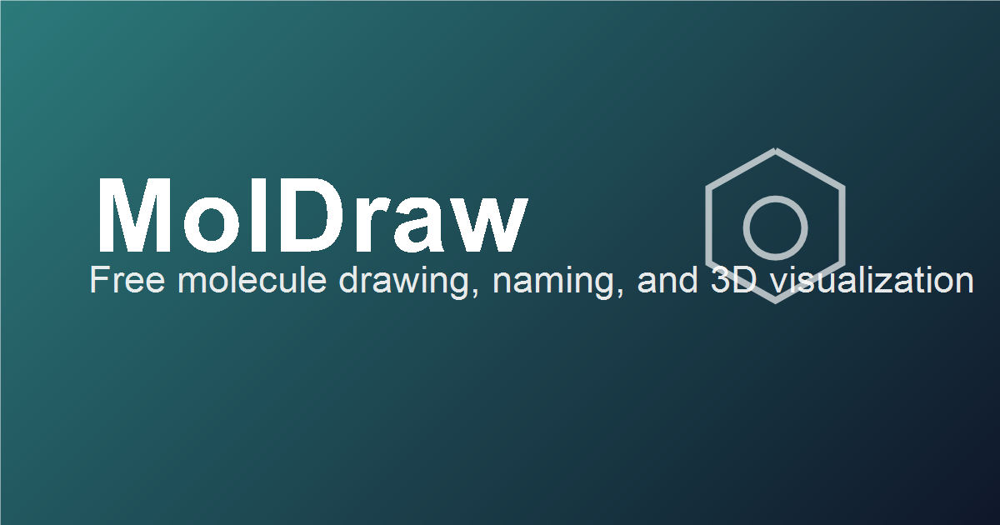

# MolDraw: Free Chemical Structure Drawing Software and ChemDraw Alternative

**Draw chemical structures online for free.** MolDraw is a browser-based molecule editor with 2D drawing, a 3D viewer, NMR and mass-spectrum prediction, and 76 free chemistry tools.

[Open MolDraw](https://www.moldraw.com) · [Free chemistry tools](https://www.moldraw.com/tools/) · [3D molecule models](https://www.moldraw.com/molecules/) · [Community](https://www.moldraw.com/community/)

## What is MolDraw?

MolDraw is a free online chemical structure drawing app made by LabCanvas. It runs in the web browser with no installation and lets students, teachers and researchers draw 2D molecules and reaction schemes, view molecules in 3D, convert between SMILES, MOL, SDF and InChI, predict NMR and mass spectra, and export images for papers, slides and worksheets.

## Key facts

| | |
|---|---|
| Name | MolDraw |
| Maker | LabCanvas |
| Website | [www.moldraw.com](https://www.moldraw.com) |
| Type | Chemical structure drawing software / molecule editor (web app) |
| Platforms | Any modern web browser (Windows, macOS, Linux, ChromeOS, Android, iOS) |
| Price | Free; Pro plan planned |
| Source code | Proprietary (not open source) |

## Molecule editor features

- **2D chemical structure drawing**: atoms, bonds, rings, charges, stereo bonds and templates
- **Structure cleanup**: one-click layout tidy-up (magic wand)
- **Reaction drawing**: arrows, conditions and multi-step schemes
- **3D molecule viewer**: ball-and-stick, space-filling and wireframe views
- **Spectra prediction**: predicted 1H/13C NMR and mass spectra
- **AI assistance** for chemistry drawing tasks
- **Lab apparatus library**: glassware and scientific illustrations
- **Import and export**: SMILES, MOL, SDF, InChI, and PNG/SVG image export

## Free online chemistry tools

All tools are free and run in the browser. Full list: [MolDraw free chemistry tools hub](https://www.moldraw.com/tools/).

### Structure drawing and 3D models

- [3D molecular model viewer](https://www.moldraw.com/tools/free-chem-tools/3d-molecular-model-viewer.html)
- [Build a molecule](https://www.moldraw.com/tools/free-chem-tools/build-a-molecule.html)
- [CAS number to structure](https://www.moldraw.com/tools/free-chem-tools/cas-number-to-structure.html)
- [Chemical reaction drawer](https://www.moldraw.com/tools/free-chem-tools/chemical-reaction-drawer.html)
- [Degree of unsaturation calculator](https://www.moldraw.com/tools/free-chem-tools/degree-of-unsaturation-calculator.html)
- [Lewis structure generator](https://www.moldraw.com/tools/free-chem-tools/lewis-structure-generator.html)
- [Molecular formula to structure](https://www.moldraw.com/tools/free-chem-tools/molecular-formula-to-structure.html)
- [Name to structure](https://www.moldraw.com/tools/free-chem-tools/name-to-structure.html)
- [Protein molecular weight calculator](https://www.moldraw.com/tools/free-chem-tools/protein-molecular-weight-calculator.html)
- [SMILES to 3D structure converter](https://www.moldraw.com/tools/free-chem-tools/smiles-to-3d-structure-converter.html)
- [SMILES to structure](https://www.moldraw.com/tools/free-chem-tools/smiles-to-structure.html)
- [TLC diagram tool](https://www.moldraw.com/tools/free-chem-tools/tlc-diagram-tool.html)
- [VSEPR molecular geometry calculator](https://www.moldraw.com/tools/free-chem-tools/vsepr-molecular-geometry-calculator.html)
- [XYZ gaussian to 2d structure](https://www.moldraw.com/tools/free-chem-tools/xyz-gaussian-to-2d-structure.html)
- [Protein viewer](https://www.moldraw.com/tools/protein-viewer/index.html)

### Name, formula and identifier to structure

- [IUPAC name to SMILES converter](https://www.moldraw.com/tools/free-chem-tools/iupac-name-to-smiles-converter.html)

### File format and identifier converters

- [CAS number to SMILES converter](https://www.moldraw.com/tools/free-chem-tools/cas-number-to-smiles-converter.html)
- [CID to SMILES converter](https://www.moldraw.com/tools/free-chem-tools/cid-to-smiles-converter.html)
- [InChI to InChIKey converter](https://www.moldraw.com/tools/free-chem-tools/inchi-to-inchikey-converter.html)
- [InChI to SMILES converter](https://www.moldraw.com/tools/free-chem-tools/inchi-to-smiles-converter.html)
- [InChIKey to InChI converter](https://www.moldraw.com/tools/free-chem-tools/inchikey-to-inchi-converter.html)
- [InChIKey to SMILES converter](https://www.moldraw.com/tools/free-chem-tools/inchikey-to-smiles-converter.html)
- [MOL to InChI converter](https://www.moldraw.com/tools/free-chem-tools/mol-to-inchi-converter.html)
- [MOL to InChIKey converter](https://www.moldraw.com/tools/free-chem-tools/mol-to-inchikey-converter.html)
- [MOL to SMILES converter](https://www.moldraw.com/tools/free-chem-tools/mol-to-smiles-converter.html)
- [MOL2 to SMILES converter](https://www.moldraw.com/tools/free-chem-tools/mol2-to-smiles-converter.html)
- [PDB to PDBQT converter](https://www.moldraw.com/tools/free-chem-tools/pdb-to-pdbqt-converter.html)
- [PDB to SMILES converter](https://www.moldraw.com/tools/free-chem-tools/pdb-to-smiles-converter.html)
- [SDF to InChI converter](https://www.moldraw.com/tools/free-chem-tools/sdf-to-inchi-converter.html)
- [SDF to InChIKey converter](https://www.moldraw.com/tools/free-chem-tools/sdf-to-inchikey-converter.html)
- [SMILES to InChI converter](https://www.moldraw.com/tools/free-chem-tools/smiles-to-inchi-converter.html)
- [SMILES to InChIKey converter](https://www.moldraw.com/tools/free-chem-tools/smiles-to-inchikey-converter.html)
- [SMILES to IUPAC name converter](https://www.moldraw.com/tools/free-chem-tools/smiles-to-iupac-name-converter.html)
- [SMILES to MOL converter](https://www.moldraw.com/tools/free-chem-tools/smiles-to-mol-converter.html)
- [SMILES to MOL2 converter](https://www.moldraw.com/tools/free-chem-tools/smiles-to-mol2-converter.html)
- [SMILES to PDB converter](https://www.moldraw.com/tools/free-chem-tools/smiles-to-pdb-converter.html)
- [SMILES to PDBQT converter](https://www.moldraw.com/tools/free-chem-tools/smiles-to-pdbqt-converter.html)
- [SMILES to SDF converter](https://www.moldraw.com/tools/free-chem-tools/smiles-to-sdf-converter.html)
- [Structure to SMILES converter](https://www.moldraw.com/tools/free-chem-tools/structure-to-smiles-converter.html)
- [XYZ to SMILES converter](https://www.moldraw.com/tools/free-chem-tools/xyz-to-smiles-converter.html)

### NMR, mass spectrometry and spectroscopy

- [Exact mass calculator](https://www.moldraw.com/tools/free-chem-tools/exact-mass-calculator.html)
- [IR spectroscopy chart](https://www.moldraw.com/tools/free-chem-tools/ir-spectroscopy-chart.html)
- [Mass spectrum predictor](https://www.moldraw.com/tools/free-chem-tools/mass-spectrum-predictor.html)
- [Molecular formula finder](https://www.moldraw.com/tools/free-chem-tools/molecular-formula-finder.html)
- [SMILES to NMR](https://www.moldraw.com/tools/free-chem-tools/smiles-to-nmr.html)
- [Structure to NMR](https://www.moldraw.com/tools/free-chem-tools/structure-to-nmr.html)

### Drug-likeness and molecular properties

- [Druglikeness calculator](https://www.moldraw.com/tools/free-chem-tools/druglikeness-calculator.html)
- [Lipinski rule calculator](https://www.moldraw.com/tools/free-chem-tools/lipinski-rule-calculator.html)
- [LogP calculator](https://www.moldraw.com/tools/free-chem-tools/logp-calculator.html)
- [PKa calculator](https://www.moldraw.com/tools/free-chem-tools/pka-calculator.html)
- [TPSA calculator](https://www.moldraw.com/tools/free-chem-tools/tpsa-calculator.html)

### Stoichiometry, solutions and general chemistry

- [AP chemistry score calculator](https://www.moldraw.com/tools/free-chem-tools/ap-chemistry-score-calculator.html)
- [Chemical equation balancer](https://www.moldraw.com/tools/free-chem-tools/chemical-equation-balancer.html)
- [Dilution calculator](https://www.moldraw.com/tools/free-chem-tools/dilution-calculator.html)
- [Electron configuration calculator](https://www.moldraw.com/tools/free-chem-tools/electron-configuration-calculator.html)
- [Empirical formula calculator](https://www.moldraw.com/tools/free-chem-tools/empirical-formula-calculator.html)
- [Grams to moles calculator](https://www.moldraw.com/tools/free-chem-tools/grams-to-moles-calculator.html)
- [Half life calculator](https://www.moldraw.com/tools/free-chem-tools/half-life-calculator.html)
- [Ideal gas law calculator](https://www.moldraw.com/tools/free-chem-tools/ideal-gas-law-calculator.html)
- [Interactive periodic table](https://www.moldraw.com/tools/free-chem-tools/interactive-periodic-table.html)
- [Limiting reagent calculator](https://www.moldraw.com/tools/free-chem-tools/limiting-reagent-calculator.html)
- [Molality calculator](https://www.moldraw.com/tools/free-chem-tools/molality-calculator.html)
- [Molar mass calculator](https://www.moldraw.com/tools/free-chem-tools/molar-mass-calculator.html)
- [Molarity calculator](https://www.moldraw.com/tools/free-chem-tools/molarity-calculator.html)
- [Molecular weight calculator](https://www.moldraw.com/tools/free-chem-tools/molecular-weight-calculator.html)
- [Net ionic equation calculator](https://www.moldraw.com/tools/free-chem-tools/net-ionic-equation-calculator.html)
- [Oxidation number calculator](https://www.moldraw.com/tools/free-chem-tools/oxidation-number-calculator.html)
- [Percent yield calculator](https://www.moldraw.com/tools/free-chem-tools/percent-yield-calculator.html)
- [PH calculator](https://www.moldraw.com/tools/free-chem-tools/ph-calculator.html)
- [SMILES notation guide](https://www.moldraw.com/tools/free-chem-tools/smiles-notation-guide.html)
- [SMILES to molecular formula](https://www.moldraw.com/tools/free-chem-tools/smiles-to-molecular-formula.html)
- [SMILES to molecular weight](https://www.moldraw.com/tools/free-chem-tools/smiles-to-molecular-weight.html)
- [Solution prep calculator](https://www.moldraw.com/tools/free-chem-tools/solution-prep-calculator.html)
- [Stoichiometry calculator](https://www.moldraw.com/tools/free-chem-tools/stoichiometry-calculator.html)
- [Structure to IUPAC name](https://www.moldraw.com/tools/free-chem-tools/structure-to-iupac-name.html)
- [Theoretical yield calculator](https://www.moldraw.com/tools/free-chem-tools/theoretical-yield-calculator.html)

## Interactive 3D molecule models

Interactive 3D pages with 2D structure, shape, bond angles and facts. Hub: [3D molecule models](https://www.moldraw.com/molecules/).

- [ 3D model](https://www.moldraw.com/molecules/acetone.html)
- [ 3D model](https://www.moldraw.com/molecules/adrenaline.html)
- [ 3D model](https://www.moldraw.com/molecules/ammonia.html)
- [ 3D model](https://www.moldraw.com/molecules/aspirin.html)
- [ 3D model](https://www.moldraw.com/molecules/atp.html)
- [ 3D model](https://www.moldraw.com/molecules/benzene.html)
- [ 3D model](https://www.moldraw.com/molecules/caffeine.html)
- [ 3D model](https://www.moldraw.com/molecules/carbon-dioxide.html)
- [ 3D model](https://www.moldraw.com/molecules/cholesterol.html)
- [ 3D model](https://www.moldraw.com/molecules/citric-acid.html)
- [ 3D model](https://www.moldraw.com/molecules/estradiol.html)
- [ 3D model](https://www.moldraw.com/molecules/ethanol.html)
- [ 3D model](https://www.moldraw.com/molecules/fructose.html)
- [ 3D model](https://www.moldraw.com/molecules/glucose.html)
- [ 3D model](https://www.moldraw.com/molecules/glycerol.html)
- [ 3D model](https://www.moldraw.com/molecules/glycine.html)
- [ 3D model](https://www.moldraw.com/molecules/hydrogen-chloride.html)
- [ 3D model](https://www.moldraw.com/molecules/melatonin.html)
- [ 3D model](https://www.moldraw.com/molecules/methane.html)
- [ 3D model](https://www.moldraw.com/molecules/methanol.html)
- [ 3D model](https://www.moldraw.com/molecules/oxygen.html)
- [ 3D model](https://www.moldraw.com/molecules/ozone.html)
- [ 3D model](https://www.moldraw.com/molecules/propane.html)
- [ 3D model](https://www.moldraw.com/molecules/serotonin.html)
- [ 3D model](https://www.moldraw.com/molecules/sucrose.html)
- [ 3D model](https://www.moldraw.com/molecules/testosterone.html)
- [ 3D model](https://www.moldraw.com/molecules/vanillin.html)
- [ 3D model](https://www.moldraw.com/molecules/vitamin-c.html)
- [ 3D model](https://www.moldraw.com/molecules/water.html)

## MolDraw vs ChemDraw, MolView and ChemSketch

| | MolDraw | ChemDraw | MolView | ChemSketch |
|---|---|---|---|---|
| Runs in browser, no install | Yes | Desktop app (web version via ChemDraw subscription) | Yes | Desktop app (Windows) |
| Free to use | Yes | Paid licence | Yes | Free edition available |
| 2D structure drawing | Yes | Yes | Yes | Yes |
| 3D viewer | Yes | Yes (Chem3D) | Yes | Yes (3D viewer) |
| NMR prediction | Yes | Yes | No | In paid add-ons |
| Reaction drawing | Yes | Yes | No | Yes |

Competitor details are based on their public product pages and may change; check each vendor for current information.

## Add-ons

MolDraw add-ons for Canva, Google Workspace (Docs, Sheets, Slides) and Microsoft Office (Word, PowerPoint, Excel) are in development. Coming soon.

## Frequently asked questions

### What is MolDraw?

MolDraw is a free, browser-based chemical structure drawing app made by LabCanvas. It lets you draw 2D molecules and reactions, view them in 3D, predict NMR and mass spectra, and export publication-quality images, with no installation.

### Is MolDraw free?

Yes. The MolDraw editor and all of the free chemistry tools listed here can be used at no cost in a web browser. A Pro plan is planned for advanced features.

### Is MolDraw a ChemDraw alternative?

Yes. MolDraw covers common ChemDraw tasks such as drawing structures and reactions, structure cleanup, name-to-structure, SMILES/MOL conversion and image export, and it runs in the browser on Windows, macOS, Linux, ChromeOS and mobile.

### Do I need to install anything?

No. MolDraw runs in any modern web browser at moldraw.com.

### Can MolDraw predict NMR spectra?

Yes. The Structure to NMR and SMILES to NMR tools give predicted 1H and 13C NMR spectra from a drawn structure or SMILES string.

### Is the MolDraw source code open source?

No. This repository is an information page only. MolDraw is proprietary software by LabCanvas; use it free at moldraw.com.

## About LabCanvas

MolDraw is built by LabCanvas, which makes science drawing tools for students, educators and researchers. Visit [moldraw.com](https://www.moldraw.com) to start drawing.

## License

This repository contains documentation only. MolDraw is proprietary software; its source code is not published. Screenshots and logos © LabCanvas.

